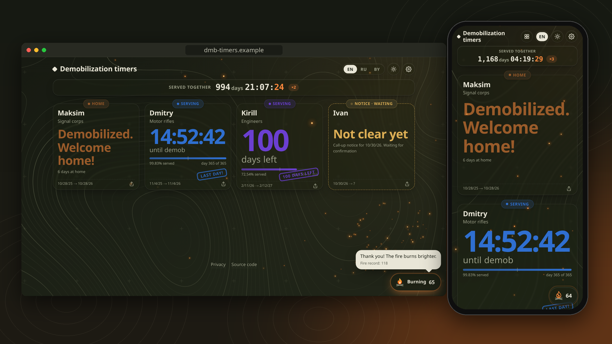
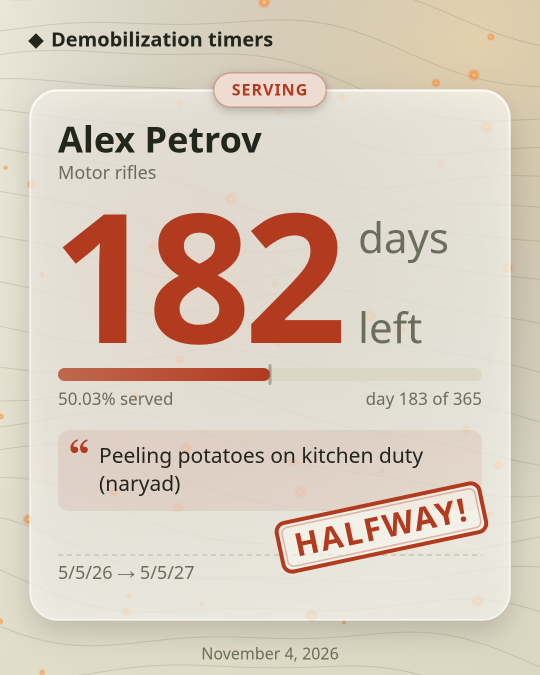

# dmb-timers

A small self-hosted website with demob (demobilization) timers: countdowns to the end of military service for one or many people on one page.



No database, no dependencies, no tracking: one Node.js file and one JSON config file.

## What is on the page

**Timer cards.** One card per person: the name on one line with the label under it, the days left, a progress bar and the current day of service. On the last day, hours, minutes and seconds become the big number. The state (civilian, starts soon, serving, home and so on) sits in the middle of the card's top edge, each in its own color. "Starts soon" and "Notice · waiting" blink gently, so they catch the eye.

**Call-up notices.** The start date can be a call-up notice. Until then the card has a "Call-up notice" chip and counts the days until the notice, and its dates end in "?". From that date the card says "Not clear yet" instead of counting down, until the admin confirms that the person has left.

**Milestones.** On the day a quarter, half or three quarters is served, and with 100, 30 and 7 days left and on the last day, the card carries an ink stamp that lands with a burst of sparks. When the day count changes while the page is open, "-1 day" floats off the number.

**Demob day.** For the first 24 hours after a timer ends, its card glows gold, carries a big "Demob!" stamp and fires salutes of sparks.

**Funny statuses.** Pictures shared from a card carry a short status that follows the real service timeline: the oath, the halfway point, "100 days to the order", the train home. Every status has its own time window, so nobody is waiting at the station two days early. The front of a card leaves them out, so the numbers get the room; they live on its back.

**Card backs.** Tap a card and it turns over. The back shows a funny status, the time until demob (or until the call-up or the notice, or since the notice, or at home for), the same time in weeks, hours, minutes, seconds or heartbeats, and what it compares to: "≈ 865 Titanic films", "≈ 94 trips to the Moon", "≈ 3,686 sloths crossing a football pitch". The status and comparisons are picked at random every time a card turns over, and neighbouring cards get different ones. Every 10 seconds a random card in view turns over by itself and turns back after a few seconds, unless you are pointing at it. Another tap anywhere on the card turns it back. The share button and the dates row around it never turn the card.

**Shared counter.** Above the cards, everyone's time served is added up into one number (or the time left for everyone, if you choose). Every second it adds one second for each person serving now, so with five people serving, the seconds run five times faster.

**Fire button.** A button in the corner lets visitors show the guys that someone is visiting and waiting for them:

- Each tap adds a log to a shared fire. A visitor can add one log every 12 hours (the browser remembers when, in local storage).
- The count starts over from zero every 45 days. Tapping the fire again while your log is still burning tells you when the next log can go in and when the fire starts over.
- The more logs, the more sparks of fire dust drift over the cards and the bigger and hotter they are. The sparks scroll with the page and light up around the part in view, so a long page scrolls as smoothly as a short one.
- A tap drops a log into the fire with a burst of sparks. Most logs are oak; some are birch (crackling white sparks) or pine (resin pops), and one in forty is golden. Logs added by other visitors arrive as sparks from below.
- The fire remembers its record, the most logs it ever had, and a tap that beats it is celebrated.
- Tap the burning fire five times quickly and see what happens.
- On the first visit, a short tip explains the button.

**Share as a picture.** Each card has a share button at the end of its dates row. It turns the card into a picture laid out like the card itself, with the state on its top edge and fire dust in front: the page title, the name, the big number, the progress, today's status, the milestone stamp, the dates and the date of the snapshot. Or its back, with the status, the time left and the comparisons. Choose the side, the language of the picture (English, Russian or Belarusian, whatever the page is in), light or dark, a post (4:5) or story (9:16) size, whether to hide the dates, and whether to show the funny status and the funny stats (the comparisons on the back). Then share it through the phone's share menu, copy it to the clipboard or save the PNG. The picture is drawn in the browser, and nothing is sent to the server.

<p align="center"></p>

**Looks.** A topographic map background with a slow wave of light running over it, glass cards, and light and dark themes (they follow the system, or switch with the sun/moon button). The interface is in English, Russian and Belarusian.

**Phones.** Each card is a wide row with big digits. A button in the header switches to two small squares per row and back, and the page remembers the choice. As on a computer, the unit goes under the number, so the number gets the full width. The header fits on one line, and the language switch becomes one button that steps through the languages.

## Quick start

A ready image is published to Docker Hub as [`severnbli/dmb-timers`](https://hub.docker.com/r/severnbli/dmb-timers) on every push to `main`:

```bash
docker run -d --name dmb-timers -p 8080:3000 \
  -e ADMIN_PASSWORD=change-me -e SESSION_SECRET=$(openssl rand -hex 32) \
  -v dmb-timers-data:/data --restart unless-stopped severnbli/dmb-timers:latest
```

Then open:

- `http://localhost:8080` for the timers
- `http://localhost:8080/admin` for the admin panel

### With Docker Compose

```bash
cp .env.example .env      # then set a real password in .env
docker compose up -d --build
```

The bundled `docker-compose.yml` builds the image from this repository and serves it on port `777`. To use the prebuilt image instead, remove the `build: .` line. Data is kept in the `timer-data` volume.

### Without Docker

Node.js 18 or newer is enough, there is nothing to install:

```bash
ADMIN_PASSWORD=change-me DATA_DIR=./data TZ=Europe/Minsk node server.js
```

### HTTPS

If the site is reachable from the internet, serve it over HTTPS. The easiest way is the bundled [Caddy](https://caddyserver.com) setup, which gets and renews a free Let's Encrypt certificate on its own:

1. Point your domain's DNS at the server and open ports 80 and 443.
2. In `.env` set `DOMAIN=timers.example.com`, `TRUST_PROXY=1` and `HTTP_BIND=127.0.0.1` (so port 777 is no longer open to the world).
3. Run `docker compose --profile https up -d`.

You can also use your own reverse proxy (set `TRUST_PROXY=1` and pass `X-Forwarded-For` and `X-Forwarded-Proto`), or let the app serve HTTPS itself with `TLS_CERT` and `TLS_KEY` (it re-reads them every 12 hours, so renewed certificates are picked up).

### Security

- Over HTTPS the server sends HSTS, and the admin cookie is marked `Secure`.
- Pages carry a strict Content-Security-Policy (scripts only from this server, inline ones by a one-time nonce), cannot be framed, and send no referrer.
- Changes are only accepted from the site itself: cross-site requests are refused, and admin requests must be JSON (on top of the `SameSite=Strict` cookie).
- Logging out revokes the session on the server. Five wrong passwords lock an address for a minute, and only a salted hash of the address is kept.
- Behind a proxy, the visitor's address is the last `X-Forwarded-For` entry (the one your proxy added), so clients cannot fake it.
- Slow requests time out, request bodies are capped, and `config.json` is written atomically and readable only by the server's user.
- The server warns at start if `ADMIN_PASSWORD` or `SESSION_SECRET` is the example value or the password is short.

## Environment variables

| Variable | Default | What it does |
| --- | --- | --- |
| `ADMIN_PASSWORD` | (required) | Password for `/admin` |
| `SESSION_SECRET` | random on every start | Signs admin sessions. Set a fixed value to stay logged in across restarts |
| `SESSION_HOURS` | `12` | How long an admin session lasts |
| `TZ` | `Europe/Minsk` | Time zone for month arithmetic (start + 6 or 12 months) and for status timing (seasons, wake-up, lights-out) |
| `PORT` | `3000` | HTTP port inside the container |
| `TRUST_PROXY` | (off) | Set to `1` behind a reverse proxy, so the login limit sees the visitor's address from `X-Forwarded-For`, and HTTPS is detected from `X-Forwarded-Proto` |
| `DOMAIN` | (none) | Domain for the bundled Caddy HTTPS setup (`--profile https`) |
| `HTTP_BIND` | `0.0.0.0` | Address port 777 is published on in `docker-compose.yml`; `127.0.0.1` with Caddy |
| `TLS_CERT`, `TLS_KEY` | (none) | PEM certificate and key paths: the app then serves HTTPS itself |
| `HTTP_PORT` | (none) | With `TLS_CERT`/`TLS_KEY`: a plain HTTP port that only redirects to HTTPS |
| `DATA_DIR` | `/data` | Where `config.json` is stored |

## Admin panel

The panel has four tabs and remembers the last one you opened. Everything except the person editor saves as soon as you change it.

### People

- **Add a person**: their editor opens right away. Set the service start and the duration: 1 year, half a year, or a custom end date.
- Tap a row to edit that person. A search box appears once there are six or more people.
- **Label** and **Message when finished** can stay empty: each visitor then sees the default text in their own language.
- **Start from now** restarts the timer from this moment.
- **Start is the call-up notice date** marks a start that is not confirmed yet. When the date comes, the person gets a **Confirm departure** button in the list.

### Fire

| Setting | Default | What it does |
| --- | --- | --- |
| Show the fire button | on | Shows or hides the button |
| One log per visitor, hours | `12` | How long one visitor waits between logs |
| Count starts over every, days | `45` | The log count goes back to zero after this many days |
| Sparks drift over the page | on | Shows or hides the fire dust |
| Sparks with no logs | `15` | Sparks on a 1440×900 screen when the fire is empty (smaller screens get fewer) |
| Sparks at full fire | `120` | Sparks on a 1440×900 screen when the fire is full |
| Logs for full fire | `100` | How many logs make a full fire. The first logs make the biggest difference |

The tab also shows the current count and when it starts over, with a **Start over** button to reset it now.

### Settings

- **Look**: page title and the map background.
- **Cards**: hours, minutes and seconds next to the days, seconds, progress bars, funny statuses on shared pictures, and the default cards per row on phones (one wide card or two small squares); visitors can switch it with the button in the header.
- **Card backs**: whether a tap turns a card over, the funny status on the back, how many comparisons it shows (0–3), how often a random card turns over by itself (in seconds, 0 for never) and how long it stays turned.
- **Shared counter**: show or hide it, and whether it counts the time served or the time left. Unconfirmed call-ups are not counted.

### History

The last 30 changes made in the panel.

## Localization

All interface text is in [`public/i18n.js`](public/i18n.js), one dictionary per language (`en-US`, `ru-RU`, `be-BY`). The first time, the language comes from the browser settings. After that the EN / RU / BY switch decides, and the choice is saved in the browser.

To add a language:

1. Add a dictionary to `DICT` and an entry to `LANGS` in `public/i18n.js`.
2. Add a text column to every status in `public/statuses.js` and to the `COL` map in `public/index.html`.
3. Add a section to `public/privacy.html`.

## Statuses

Statuses are in [`public/statuses.js`](public/statuses.js). Each entry has the phases it shows in (`soon`, `summons`, `serve`, `done`), a rule, and the text in each language:

```js
['serve', {l: [0, 2], w: 3}, 'Running around with the clearance sheet', 'Бегает с обходным листом', 'Бегае з абходным лістом'],
```

Rule keys are day ranges `[min, max)`, and `max` can be left out:

| Key | Meaning |
| --- | --- |
| `u` | days until the call-up |
| `d` | days served |
| `l` | days left |
| `a` | days since demobilization |
| `p` | percent served |
| `m` | months (server time zone) |
| `md` | a date range as `MMDD` (server time zone) |
| `h` | an hour range (server time zone) |
| `w` | weight: higher shows up more often |

The page picks a status at random, weighted by `w`, from those whose window fits. It changes every 3 hours and is the same for every visitor.

## Privacy

- No cookies for visitors, nothing loaded from third parties.
- The fire button keeps only a shared count. The wait between one visitor's logs is kept in their browser's local storage, not on the server.
- Pictures of cards are drawn in the visitor's browser; nothing about them reaches the server.
- Failed admin logins are tracked by a salted hash of the IP address only, in memory, for a few minutes.
- Names and dates entered in the admin panel are public, so get people's consent before you add them.

The full notice is at `/privacy` and is linked from every page.

## License

[GNU AGPL v3](LICENSE). If you run a modified version for others, you must offer them its source code. The "Source code" link in the page footer points to this repository; change it if you publish a fork.
