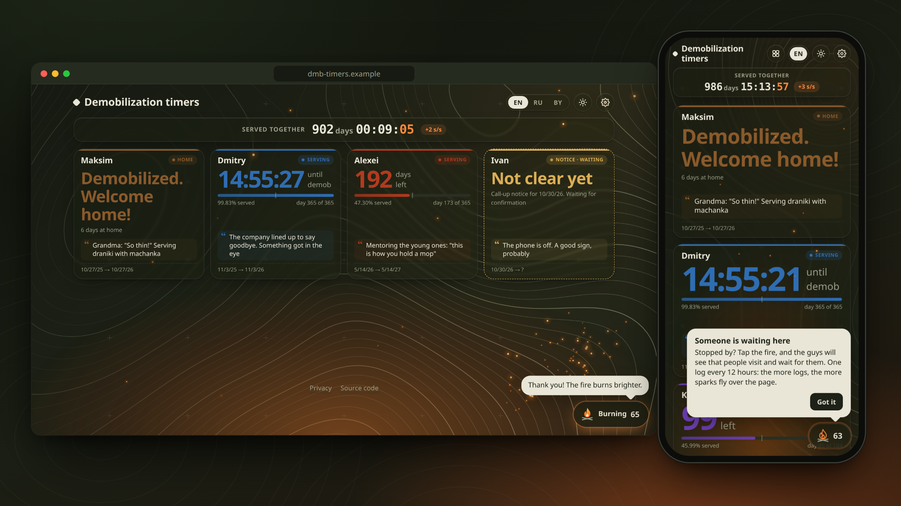
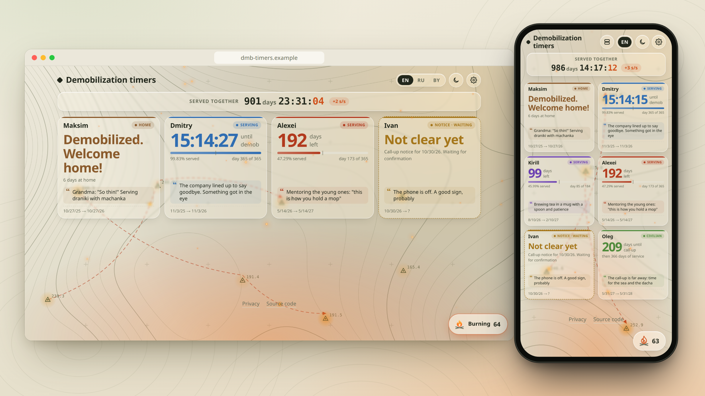
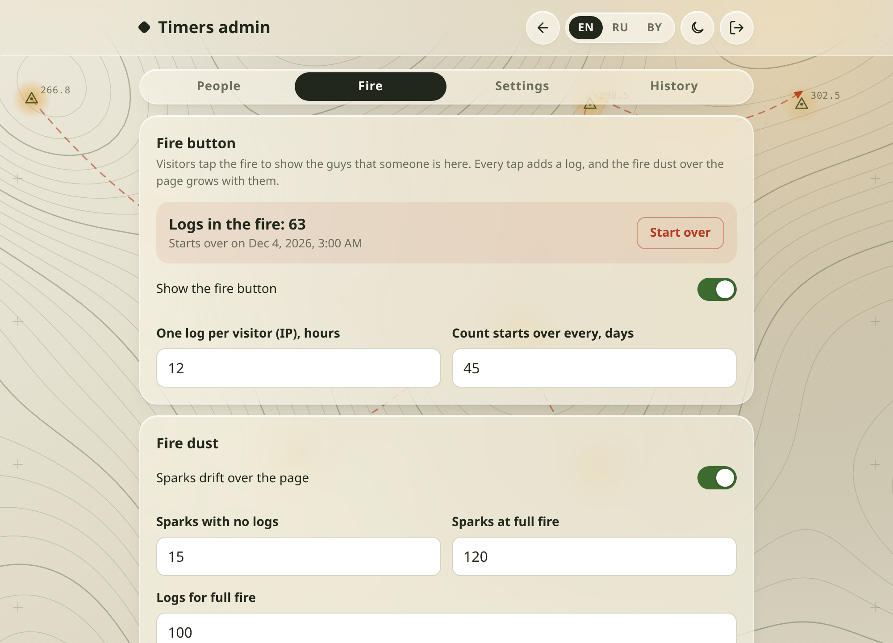

# dmb-timers

A small self-hosted website with demob (demobilization) timers: countdowns to the end of military service for one or many people on one page.



<table>
  <tr>
    <td width="50%"></td>
    <td width="50%"></td>
  </tr>
</table>

No database, no dependencies, no tracking: one Node.js file and one JSON config file.

## What is on the page

**Timer cards.** One card per person, with the days left, a progress bar and the current day of service. On the last day, hours, minutes and seconds become the big number. Each state has its own color: civilian (green), starts soon (orange), serving, and home.

**Call-up notices.** The start date can be a call-up notice. From that date the card says "Not clear yet" instead of counting down, until the admin confirms that the person has left.

**Funny statuses.** Each card shows a short status that follows the real service timeline: the oath, the halfway point, "100 days to the order", the train home. Every status has its own time window, so nobody is waiting at the station two days early.

**Shared counter.** Above the cards, everyone's time served is added up into one number (or the time left for everyone, if you choose). Every second it adds one second for each person serving now, so with five people serving, the seconds run five times faster.

**Fire button.** A button in the corner lets visitors show the guys that someone is visiting and waiting for them:

- Each tap adds a log to a shared fire. One visitor (IP address) can add one log every 12 hours.
- The count starts over from zero every 45 days.
- The more logs, the more sparks of fire dust drift over the cards, the bigger and hotter they are, and the brighter the glow from the bottom of the screen.
- A tap throws a burst of sparks. Logs added by other visitors arrive as sparks from below.
- On the first visit, a short tip explains the button.

**Looks.** A topographic map background with glowing trig points and routes, glass cards, and light and dark themes (they follow the system, or switch with the sun/moon button). The interface is in English, Russian and Belarusian.

**Phones.** Each card is a wide row with big digits. A button in the header switches to two small squares per row and back, and the page remembers the choice. The header fits on one line, and the language switch becomes one button that steps through the languages.

## Quick start

A ready image is published to Docker Hub as [`severnbli/dmb-timers`](https://hub.docker.com/r/severnbli/dmb-timers) on every push to `main`:

```bash
docker run -d --name dmb-timers -p 8080:3000 \
  -e ADMIN_PASSWORD=change-me -e SESSION_SECRET=$(openssl rand -hex 32) \
  -v dmb-timers-data:/data --restart unless-stopped severnbli/dmb-timers:latest
```

Then open:

- `http://localhost:8080` for the timers
- `http://localhost:8080/admin` for the admin panel

### With Docker Compose

```bash
cp .env.example .env      # then set a real password in .env
docker compose up -d --build
```

The bundled `docker-compose.yml` builds the image from this repository and serves it on port `777`. To use the prebuilt image instead, remove the `build: .` line. Data is kept in the `timer-data` volume.

### Without Docker

Node.js 18 or newer is enough, there is nothing to install:

```bash
ADMIN_PASSWORD=change-me DATA_DIR=./data TZ=Europe/Minsk node server.js
```

If the site is reachable from the internet, put it behind a reverse proxy with HTTPS.

## Environment variables

| Variable | Default | What it does |
| --- | --- | --- |
| `ADMIN_PASSWORD` | (required) | Password for `/admin` |
| `SESSION_SECRET` | random on every start | Signs admin sessions. Set a fixed value to stay logged in across restarts |
| `SESSION_HOURS` | `12` | How long an admin session lasts |
| `TZ` | `Europe/Minsk` | Time zone for month arithmetic (start + 6 or 12 months) and for status timing (seasons, wake-up, lights-out) |
| `PORT` | `3000` | HTTP port inside the container |
| `TRUST_PROXY` | (off) | Set to `1` behind a reverse proxy, so the login and fire button limits see the visitor's address from `X-Forwarded-For` |
| `DATA_DIR` | `/data` | Where `config.json` is stored |

## Admin panel

The panel has four tabs and remembers the last one you opened. Everything except the person editor saves as soon as you change it.

### People

- **Add a person**: their editor opens right away. Set the service start and the duration: 1 year, half a year, or a custom end date.
- Tap a row to edit that person. A search box appears once there are six or more people.
- **Label** and **Message when finished** can stay empty: each visitor then sees the default text in their own language.
- **Start from now** restarts the timer from this moment.
- **Start is the call-up notice date** marks a start that is not confirmed yet. When the date comes, the person gets a **Confirm departure** button in the list.

### Fire

| Setting | Default | What it does |
| --- | --- | --- |
| Show the fire button | on | Shows or hides the button |
| One log per visitor (IP), hours | `12` | How long one visitor waits between logs |
| Count starts over every, days | `45` | The log count goes back to zero after this many days |
| Sparks drift over the page | on | Shows or hides the fire dust |
| Sparks with no logs | `15` | Sparks on a 1440×900 screen when the fire is empty (smaller screens get fewer) |
| Sparks at full fire | `120` | Sparks on a 1440×900 screen when the fire is full |
| Logs for full fire | `100` | How many logs make a full fire. The first logs make the biggest difference |

The tab also shows the current count and when it starts over, with a **Start over** button to reset it now.

### Settings

- **Look**: page title and the map background.
- **Cards**: hours, minutes and seconds next to the days, seconds, progress bars, statuses, and the default cards per row on phones (one wide card or two small squares); visitors can switch it with the button in the header.
- **Shared counter**: show or hide it, and whether it counts the time served or the time left. Unconfirmed call-ups are not counted.

### History

The last 30 changes made in the panel.

## Localization

All interface text is in [`public/i18n.js`](public/i18n.js), one dictionary per language (`en-US`, `ru-RU`, `be-BY`). The first time, the language comes from the browser settings. After that the EN / RU / BY switch decides, and the choice is saved in the browser.

To add a language:

1. Add a dictionary to `DICT` and an entry to `LANGS` in `public/i18n.js`.
2. Add a text column to every status in `public/statuses.js` and to the `COL` map in `public/index.html`.
3. Add a section to `public/privacy.html`.

## Statuses

Statuses are in [`public/statuses.js`](public/statuses.js). Each entry has the phases it shows in (`soon`, `summons`, `serve`, `done`), a rule, and the text in each language:

```js
['serve', {l: [0, 2], w: 3}, 'Running around with the clearance sheet', 'Бегает с обходным листом', 'Бегае з абходным лістом'],
```

Rule keys are day ranges `[min, max)`, and `max` can be left out:

| Key | Meaning |
| --- | --- |
| `u` | days until the call-up |
| `d` | days served |
| `l` | days left |
| `a` | days since demobilization |
| `p` | percent served |
| `m` | months (server time zone) |
| `md` | a date range as `MMDD` (server time zone) |
| `h` | an hour range (server time zone) |
| `w` | weight: higher shows up more often |

The page picks a status at random, weighted by `w`, from those whose window fits. It changes every 3 hours and is the same for every visitor.

## Privacy

- No cookies for visitors, nothing loaded from third parties.
- The fire button keeps only a shared count. To allow one log per visitor, a salted hash of the IP address stays in memory until the wait is over. It is never written to disk.
- Names and dates entered in the admin panel are public, so get people's consent before you add them.

The full notice is at `/privacy` and is linked from every page.

## License

[GNU AGPL v3](LICENSE). If you run a modified version for others, you must offer them its source code. The "Source code" link in the page footer points to this repository; change it if you publish a fork.
