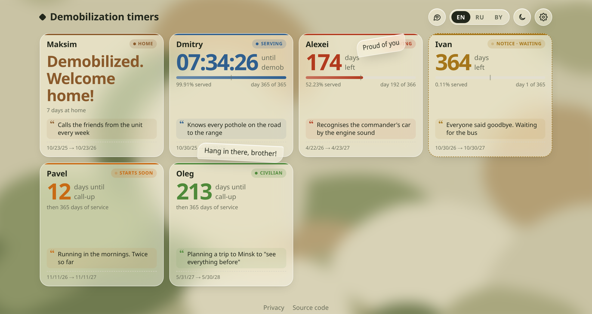
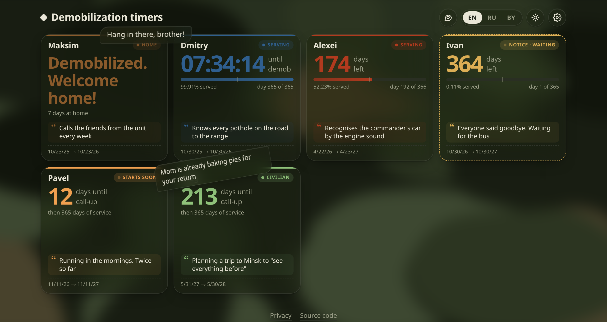

# dmb-timers

A small self-hosted website for posting demob (demobilization) timers: countdowns to the end of military service for one or many people on a single page.

<table>
  <tr>
    <td width="50%">
      
    </td>
    <td width="50%">
      
    </td>
  </tr>
</table>

- Days until the end of service, a progress bar, and the current day of service. In the last day the hours, minutes and seconds become the big number; next to the days they are optional
- Card states in their own colors: civilian (green), starts soon (orange), serving, and home
- A call-up notice date can be the start of service: from that date the card shows "Notice · waiting" until the admin confirms that the person has left
- Words of support: visitors send a word or a few sentences, and they drift down over the cards like leaves
- A moving camouflage background behind translucent glass cards, in light and dark variants
- Funny statuses that follow the real service timeline: the oath, the halfway point, "100 days to the order", the train home. Each status has its own time window (days served or days left, season, time of day), so nobody is waiting at the train station two days early
- Interface in English, Russian and Belarusian, with a language switch on every page
- Square timer cards that fit any screen, two per row on phones
- Light and dark themes: they follow the system setting, or can be switched with the sun/moon button
- A password-protected admin panel to add people and set service dates
- No database, no dependencies, no tracking. One Node.js file and a JSON config file

## Quick start (Docker image)

A ready image is published to Docker Hub as [`severnbli/dmb-timers`](https://hub.docker.com/r/severnbli/dmb-timers) on every push to `main`.

```bash
docker run -d --name dmb-timers -p 8080:3000 -e ADMIN_PASSWORD=change-me -e SESSION_SECRET=$(openssl rand -hex 32) -v dmb-timers-data:/data --restart unless-stopped severnbli/dmb-timers:latest
```

Open `http://localhost:8080` for the timers and `http://localhost:8080/admin` for the admin panel.

## Docker Compose

1. Copy the example settings and set a real password:

   ```bash
   cp .env.example .env
   ```

2. Start it:

   ```bash
   docker compose up -d --build
   ```

The bundled `docker-compose.yml` builds the image from this repository and publishes it on port `777`. To use the prebuilt image instead, replace `build: .` with `image: severnbli/dmb-timers:latest`. Data is kept in the `timer-data` volume.

## Build the image yourself

```bash
docker build -t dmb-timers .
```

## Run without Docker

Node.js 18 or newer is enough. There is nothing to install.

```bash
ADMIN_PASSWORD=change-me DATA_DIR=./data TZ=Europe/Minsk node server.js
```

## Configuration

| Variable | Default | Description |
| --- | --- | --- |
| `ADMIN_PASSWORD` | (required) | Password for `/admin` |
| `SESSION_SECRET` | random on every start | Signs admin sessions. Set a fixed value to stay logged in across restarts |
| `SESSION_HOURS` | `12` | How long an admin session lasts |
| `TZ` | `Europe/Minsk` | Time zone for month arithmetic (start + 6 or 12 months) and for status timing (seasons, wake-up, lights-out) |
| `PORT` | `3000` | HTTP port inside the container |
| `TRUST_PROXY` | (off) | Set to `1` behind a reverse proxy, so login and word limits use the visitor's address from `X-Forwarded-For` |
| `DATA_DIR` | `/data` | Where `config.json` is stored |

Put the site behind a reverse proxy with HTTPS if it is reachable from the internet.

## Using the admin panel

- **Add a person**, then open their card to set the service start and the duration: 1 year, half a year, or a custom end date.
- **Label** and **Message when finished** can be left empty. Each visitor then sees the default text in their own language.
- **Start from now** restarts the timer from the current moment.
- **Start is the call-up notice date** marks a start that is not confirmed yet. When the date comes, the person gets a **Confirm departure** button in the list.
- **Page settings** are grouped into Look, Cards and Words of support, and save as soon as you change them: the background, the clock next to the days, seconds, progress bars, statuses, and whether visitors can send words.
- **Words of support** are limited to 3 per visitor and 21 for the whole site per hour by default, and kept for 7 days (0 keeps them). Delete one with its × button, or all at once.

## Localization

All interface text lives in [`public/i18n.js`](public/i18n.js), with one dictionary per language (`en-US`, `ru-RU`, `be-BY`). The language is picked from the browser settings the first time and can be switched with the EN / RU / BY buttons. The choice is saved in the browser's local storage.

To add a language, add a dictionary to `DICT` and an entry to `LANGS`, then add a text column to every status in `public/statuses.js` and to the `COL` map in `public/index.html`, and add a section to `public/privacy.html`.

## Statuses

Statuses are in [`public/statuses.js`](public/statuses.js). Each entry has phases (`soon`, `summons`, `serve`, `done`), a rule, and the text in each language:

```js
['serve', {l: [0, 2], w: 3}, 'Running around with the clearance sheet', 'Бегает с обходным листом', 'Бегае з абходным лістом'],
```

Rule keys are day ranges `[min, max)`, where `max` can be left out:

- `u`: days until the call-up
- `d`: days served
- `l`: days left
- `a`: days since demobilization
- `p`: percent served

Calendar and clock keys use the server time zone:

- `m`: months
- `md`: a date range as `MMDD`
- `h`: an hour range

`w` is a weight that makes short milestones show up more often. The page picks a status at random, weighted by `w`, from those whose window fits. The status changes every 3 hours and is the same for every visitor.

## Privacy

The site sets no cookies for visitors and loads nothing from third parties. Words of support are stored without names; the IP address used for their limit stays in memory for an hour. The full notice is at `/privacy` and is linked from every page. Names and dates entered in the admin panel are public, so get people's consent before you add them.

## License

[GNU AGPL v3](LICENSE). If you run a modified version for others, you must offer them its source code. The "Source code" link in the page footer points to this repository; change it if you publish a fork.
